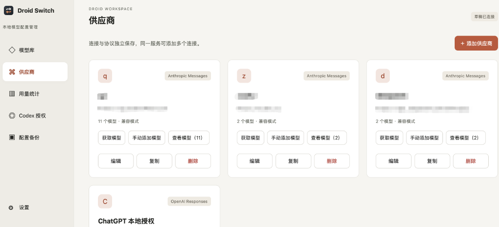
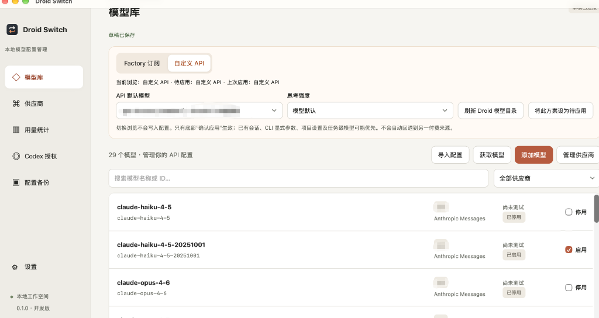
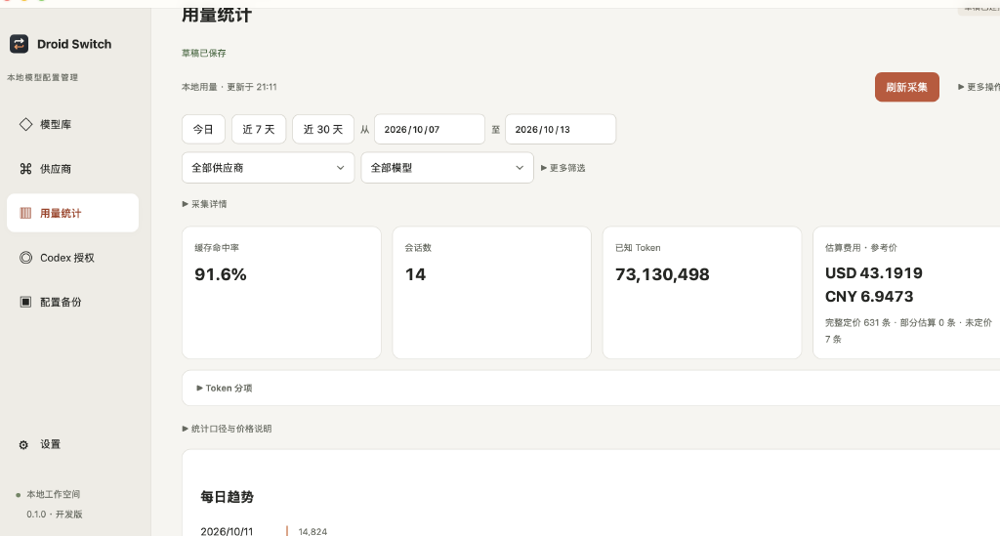
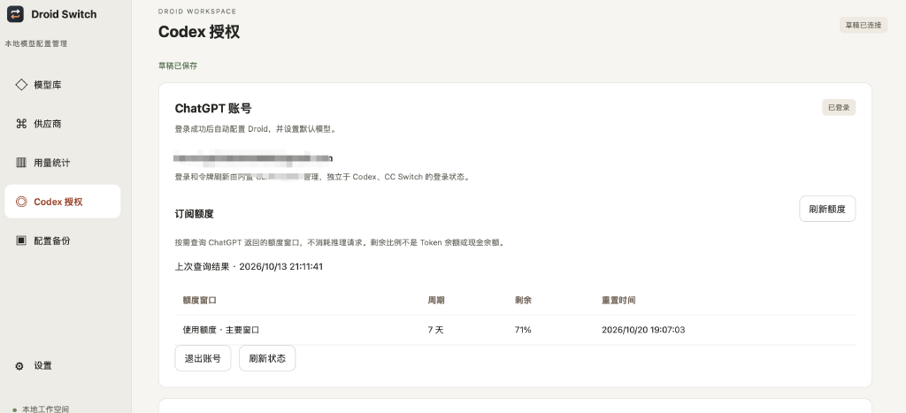
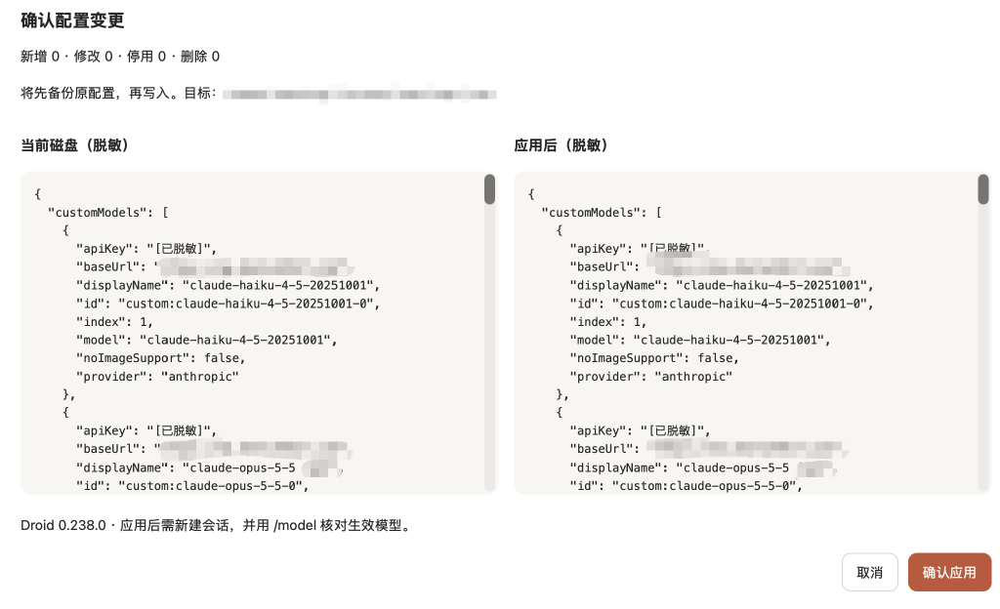

# Droid Switch

一个用于管理 **Factory Droid CLI** 模型与供应商配置的本地桌面工具。使用 Tauri 2、React、TypeScript 和 Rust 构建，草稿保存在本机 SQLite 中。

> 当前为 **0.2.1 测试版**。macOS Apple Silicon 已提供安装包；Windows 安装与真实会话行为仍待验证。项目为独立工具，与 Factory、OpenAI 没有官方关联。

[下载测试版](https://github.com/thin2/droidswitch/releases) · [反馈问题](https://github.com/thin2/droidswitch/issues) · [Windows 构建与实测](docs/windows-testing.md)

## 能做什么

- **管理多个供应商**：分别配置地址、协议和凭据，支持环境变量引用及直接填写 API Key。
- **获取或手动添加模型**：在供应商卡片获取模型列表，也可每行一个 ID 批量添加；同供应商重复条目跳过，已有参数保留。
- **区分模型来源**：相同模型 ID 可属于不同供应商，模型列表用供应商标签区分，并支持筛选。
- **管理官方/API 方案**：保存模型选择和思考强度配置，浏览不同方案不会立即改写 Droid。
- **预览后应用**：先保存草稿，再预览配置差异并确认写入；支持冲突检测、备份与恢复。
- **导入 CC Switch 配置**：只读导入来源数据，不修改 CC Switch；凭据导入需要按界面提示确认。
- **连接测试与用量统计**：可发起调用测试，查看本地用量数据的聚合分析和成本估算。
- **CPA 配额查询**（v0.2.0+）：登录 Codex 账号后，手动刷新查看订阅速率限制和重置时间。


## 自动更新

应用内置自动更新功能，支持 macOS 和 Windows 平台（Linux 需手动下载）。

### 使用方法

1. 打开应用，点击侧栏的"设置"
2. 在"软件更新"区域点击"检查更新"
3. 如有新版本，点击"立即更新"即可自动下载并安装
4. 安装完成后应用将自动重启

### 更新检查

- 应用不会自动后台检查更新，需要手动触发
- 更新前会显示版本号、更新说明和发布日期
- 下载的更新包经过数字签名验证，确保安全性
- Linux 平台会提供 GitHub Releases 的下载链接
## 界面预览

### 供应商管理


配置多个供应商，分别管理连接地址、协议和凭据。支持手动添加模型或从供应商获取模型列表。

### 模型列表与筛选


按供应商筛选模型，相同 API 模型 ID 可属于不同供应商。支持批量启用、快速搜索和标签管理。

### Google Gemini 原生协议（本地桥接）

供应商或模型覆盖协议选 `google-gemini` 后，应用把 Droid 条目写为 `generic-chat-completion-api`，地址为 `http://127.0.0.1:18318/proxy/{供应商ID}/v1`。原供应商地址仍保存在应用内，上游请求使用原生 `generateContent`，不是 OpenAI Responses，也不是 Interactions。

1. 原生基础地址例如 `https://generativelanguage.googleapis.com/v1beta`；仅填主机时默认 `/v1beta`。已有版本和反向代理路径前缀原样保留。不要填完整 `:generateContent` URL、查询参数或 OpenAI 兼容地址。
2. **更新后需重新“预览并应用”配置，再新开 Droid 会话**，仅保存草稿不会生效。旧错误的 `provider: openai` 条目不会自动被磁盘外的更新修复。
3. **使用期间必须保持 Droid Switch 运行**。代理在桌面应用启动时运行；浏览器开发页面不能启动它。18318 被占用时不会复用未知服务，应用 Gemini 配置会被阻止；先处理冲突再重启，勿向未知监听程序发送密钥。
4. 环境变量凭据要求 **Droid Switch 和 Droid 两个进程都能读取同一值**；Finder 启动的应用不一定继承终端变量。修改环境后重启两者并重新应用。代理只接受已应用且启用的 Gemini 模型。
5. 旧的**未接管** Gemini 条目不会被自动删改。如出现重名/错误旧条目，在设置页重新载入配置，明确接管该条目（若提示可关联已有模型，核对后关联）；移除旧默认引用，再禁用或删除已接管的旧模型，预览确认仅删除目标条目后应用。随后保留/添加正确的原生 Gemini 模型并应用。不要为消除重名直接删除整份 settings.json；无把握时保留备份并先核对差异。

支持文本多轮、函数工具与工具结果、内联 base64 图片（模型须支持并开启图片输入）。`stream=true` 返回 **等待完整 generateContent 结果后的 SSE**，不是实时逐 token 输出；usage 按 `stream_options.include_usage` 返回。远程图片 URL、音视频、生成图片、内置搜索工具、严格工具 schema、未支持的请求参数会明确报错，不会静默省略。工具 thought signature 随 opaque 工具 ID 往返；文本部分的 signature 无法经普通 Chat Completions 历史完整保留。

配置的额外请求头由代理发到上游；Host、Content-Length、Transfer-Encoding、Connection、Content-Type、x-goog-api-key 由桥接层管理。每次请求及响应上限 8 MiB，上游总超时 120 秒，不跟随重定向。原生桥接不会使用环境 HTTP proxy 自动转发。

支持 Droid 对 Gemini 自动发送的 `reasoning_effort`：minimal/low/medium/high 转为原生 `thinkingConfig.thinkingLevel`。

连接测试目前仍使用独立的 **Interactions** API；测试成功/失败都不能代替 `generateContent` 的实际会话验证。已通过本地合成 HTTP 测试及真实 Droid 的单轮 Gemini 文本会话；**真实工具调用往返测试超时，尚未完成验收**，不能据此宣称所有代理式编码任务均可用。

### 用量统计（v0.2.0+）


查看本地用量数据的聚合分析，包含 token 分布、会话数、成本估算和每日趋势。支持按供应商、模型和时间范围筛选。

### CPA 配额查询（v0.2.0+）


登录 Codex 账号后，手动刷新查看订阅速率限制。显示主窗口和次窗口的剩余百分比、限额和重置时间。

### 配置预览与应用


应用前预览配置差异，检查新增、修改和删除的模型。支持冲突检测和并排对比。

## 安装

### macOS（M 系列芯片）

1. 前往 [Releases](https://github.com/thin2/droidswitch/releases)，下载最新的 `.dmg` 或 `.tar.gz` 附件
2. 验证校验和（Release 说明中提供 SHA-256）
3. 解压并拖入 Applications，替换旧版前先退出应用
4. 首次启动可能提示「来自身份不明的开发者」，在系统偏好设置 → 安全性与隐私中允许

安装包采用 ad-hoc 签名，尚未经过 Apple 公证。Release 说明会标明版本与最新源码的差异。目前未提供 Intel Mac 安装包。

### Windows

暂未提供经过真机验收的 Windows 安装包。开发者可以按 [Windows 构建与实测](docs/windows-testing.md) 在本机生成 NSIS 安装程序。仓库包含 GitHub Actions 构建流程，**流水线成功不等于完成 Windows 真机验证**。

## 第一次使用

1. **准备 Droid CLI**：配置写入要求版本 **≥ 0.238.0**（接受三段数字版本号）。在设置页确认应用能找到 Droid；最低版本检查不代表已验证所有未来版本。
2. **添加供应商**：填写连接名称、服务商要求的基础地址和 API 协议。不要把模型厂商与 API 协议混为一谈；地址不会自动补删 `/v1`。
3. **配置凭据**：选择“直接写入 API Key”后填写密钥；或选择环境变量方式，只填写变量名，并确保启动 Droid 的终端能读取该变量。
4. **添加模型**：点击供应商卡片的“获取模型”；若服务商不提供目录接口，选择“手动添加模型”，每行填写一个准确 ID。
5. **选择方案并应用**：添加和编辑先保存草稿。选择 API 默认模型、设为待应用，再点击底部“预览并应用”，核对差异后确认。
6. **在 Droid 中验证**：重新启动 Droid 或开启新会话，在 `/model` 中选择并确认模型。已有会话、CLI 参数和项目级设置可能覆盖默认选择。

Droid Switch 不替代 Factory 登录。配置第三方 API Key 后，Droid 仍可能要求登录 Factory 账号。调用测试会向所选供应商发送请求，可能消耗额度。

### 用量统计（v0.2.0+）

在侧栏"用量"页面查看本地使用数据：

- **多维度追踪**：输入、缓存读取、缓存写入、输出、思考 token
- **成本估算**：内置 48 个模型参考价（OpenAI、Claude、DeepSeek），支持自定义单价
- **聚合分析**：按供应商、模型查看用量趋势，支持时间筛选和分页
- **CSV 导出**：导出详细记录用于外部分析

**采集路径设置**：在设置页配置 Droid 数据目录（默认 `~/.factory`）和日志目录。点击"扫描用量"手动采集，或在页面打开时自动扫描。

**定价管理**：在"定价"标签页查看参考价，添加自定义单价覆盖特定模型。已计价的历史记录不受影响；未计价记录会自动回填。

**支持范围**：当前支持具有稳定 ID 和时间戳的会话快照（`*.settings.json`）和 agent 日志。部分格式仍待完整支持，未识别数据不应视为零用量。

### CPA 配额查询（v0.2.0+）

登录 Codex 账号后，在"Codex 授权"页面查看订阅速率限制：

- 手动点击"刷新配额"查询 wham/usage 端点
- 查看主窗口和次窗口的剩余百分比、限额和重置时间
- 切换账号时自动重新加载；刷新失败时标记数据过期

配额数据不会自动轮询，不消耗推理额度。查询需要有效的 CPA 管理令牌。

### 常见问题

**获取不到模型怎么办？** 先确认协议、地址与凭据；部分供应商不提供模型列表接口，可以直接批量手动添加。手动添加不会验证该 ID 是否真实可用。

**同一个模型接入多个供应商会冲突吗？** 在本软件中它们是独立记录，可以按供应商筛选，分别配置参数。应用后仍需在你的 Droid 版本中确认选择结果。

**关闭 Droid 后为什么仍提示配置冲突？** 关闭进程不会恢复已经写入磁盘的内容。在设置页的“外部配置模型”点击“重新载入当前配置”，查看具体变化字段。Droid 新增合法的 id/index 元数据不会被判为冲突；修改已有字段仍需明确处理。

- **采用文件配置**：选择对应的磁盘条目，用它更新该模型，保留模型身份及默认方案引用。接口或凭据变化不会覆盖其他模型的共享供应商。
- **使用应用草稿**：选择对应条目后保留草稿；点击“预览并应用”，核对覆盖范围并确认写入。丢弃草稿会恢复到本次选定的文件配置。
- **关联已有模型**：已有相同接口、协议和 API 模型时，接管要求明确关联原记录；确需同站另一个连接时，可明确选择新建独立连接与模型。
- **条目缺失或重复**：应用不会猜测对应关系。先整理磁盘文件并重新载入，或使用解除旧接管入口；解除前需清除该模型的默认引用。

诊断只显示变化字段，不显示 Key 或请求头的值。操作期间文件再次变化会中止处理，需重新载入。

**图片支持和 401 如何检查？** 对供应商确认支持图片的模型，在模型编辑器开启图片输入并应用。401 先通过连接测试核对 Key、接口和协议；重建接管关系不会修复认证错误。配置文件中的 Key 未脱敏也不代表服务端一定接受。

**如何在两个供应商之间切换同一模型？** 分别添加供应商和模型；模型库和供应商页会自动提示重名，点击“查看命名建议”，确认采用如 `claude-opus-5-5 (QA)`、`claude-opus-5-5 (zzshu)` 的名称并保存草稿。API 模型 ID 不变。供应商同名或建议名已占用时会增加编号；已有唯一自定义名称保留。预览会检查最终配置（含外部模型）的重名，即使未选择默认方案也会拦截。选择 API 默认模型后，预览并确认应用。

## 数据与隐私

- 草稿、备份和支持格式的用量数据保存在本机。获取模型和调用测试会连接你配置的服务商。
- 直接填写的 API Key 可能以明文存在于本地数据库、Droid 配置及备份中。环境变量引用方式要求对应进程实际能读取变量。
- 本项目不附带可用的 API Key、Factory 登录信息或个人配置。请使用自己的账号与凭据。
- 提交 Issue 时请移除密钥、请求头、会话正文及个人路径；不要上传数据库、登录文件或配置备份。

## 当前限制

- Windows 安装、完整跨平台行为与部分 Droid 配置优先级仍待真实环境验收。
- 用量采集支持会话快照和 agent 日志，**部分原生日志格式仍待完整支持**。未识别的数据不应视为零用量，详见 [支持范围](planning/droid-usage-contract.md)。
- CPA 配额查询需要有效的管理令牌；订阅用量估算基于参考价，不代表实际账单。
- 自动供应商回退尚未实现。
- 公共仓库从脱敏快照开始；规划记录中的旧本地提交号不一定能在公共历史中找到。

## 本地开发

需要 Node.js **≥22.12**、Rust **≥1.90**（建议 stable），以及 [Tauri 平台依赖](https://v2.tauri.app/start/prerequisites/)。macOS 可先运行 `bash scripts/setup-deps-macos.sh`。

```sh
git clone https://github.com/thin2/droidswitch.git
cd droidswitch
npm ci
npm run tauri dev
```

`npm run dev` 仅启动浏览器界面，不能代替桌面版操作真实本地配置。

### 检查与测试

```sh
npm run build
npm test
cargo test --locked --manifest-path src-tauri/Cargo.toml
cargo clippy --locked --manifest-path src-tauri/Cargo.toml --all-targets -- -D warnings
npm run test:ui
```

浏览器测试默认使用已安装的 Chrome，并通过合成 IPC 数据隔离真实配置。使用 Playwright Chromium 时先安装浏览器，再设置 `PLAYWRIGHT_CHANNEL=chromium`。可用 `PLAYWRIGHT_PORT` 指定独立测试端口。

### 打包

macOS：

```sh
npm run package:mac
```

Windows PowerShell：

```powershell
powershell -ExecutionPolicy Bypass -File .\scripts\build-windows.ps1
```

产物位于 `src-tauri/target/release/bundle/`。对外分发前，请检查签名、校验值及编译产物中可能嵌入的本机路径。

### Codex / ChatGPT 本地授权（预览）

支持 macOS (Apple Silicon / Intel)、Windows (x64 / ARM64) 和 Linux (x64 / ARM64) 平台，内置固定的 CLIProxyAPI 8.0.27。在侧栏“Codex 授权”中登录，在系统浏览器完成授权后自动备份并写入 Droid 配置，接入代理目录中的模型并选定默认模型。新建 Droid 会话即可使用，或在 /model 中切换；页面也可更换默认模型。若存在其他未应用草稿或配置冲突，保留登录并提示处理后重试，不会一并应用无关草稿。CLI 显示名附带 `(ChatGPT)`，与其他供应商区分。模型目录不是权限保证，真实调用取决于账号权限及代理兼容性。

- 本机接口固定 `http://127.0.0.1:18317/v1`，授权回调仅监听 `127.0.0.1:1455`；端口冲突会明确失败。
- 使用模型时须保持本应用及本地服务运行；重新打开应用后手动启动服务。正常退出应用会停止自有代理进程。
- 首版单账号；退出账号停止代理并删除本应用保存的凭据，不会注销 Codex / CC Switch，也不会撤销服务端所有会话。已有 Droid 模型配置仍保留。
- 令牌由 CPA 独占刷新，保存在应用数据目录的 `codex-proxy/auth` 中，目录访问权限限当前用户，尚未使用系统钥匙串；只有本地客户端密钥进入草稿及 Droid 配置。
- 当前是 CPA 兼容路线，不是 Droid Switch 自有的官方 SIWC 客户端。真实登录、令牌续期、多轮工具调用需要在对应平台进行专项验收。订阅用量不能用 API 参考价代表实际账单。

打包前运行 `python3 scripts/prepare-codex-proxy.py` 会自动检测平台并下载对应版本（macOS 打包脚本 `npm run package:mac` 已包含此步）。下载固定官方发布资产并核验两级 SHA-256；不跟随 latest。原始二进制不提交 Git，版本、摘要与 MIT 许可在 `src-tauri/resources/codex/`。完整组件约 20-22 MiB（视平台而定），尚未裁剪其他代理实现。

授权适配器测试：`cargo test --manifest-path src-tauri/Cargo.toml codex --lib`；实际代理生命周期测试需本地监听权限：`cargo test --manifest-path src-tauri/Cargo.toml codex_real_sidecar_lifecycle --lib -- --ignored`。此测试生成并取消空授权会话，不打开浏览器、不使用真实账号或推理额度。

## 许可证与致谢

本仓库目前未附开源许可证；代码公开可见不代表授予任意使用、修改或再分发的许可。

**第三方组件**：
- [CLIProxyAPI](https://github.com/Router-For-ME/CLIProxyAPI) (MIT License) - 用于 Codex / ChatGPT 本地授权功能。该组件的原始许可证保留在 `src-tauri/resources/codex/LICENSE`。我们使用固定版本 8.0.27，遵循其 MIT 许可证条款，包括在所有副本中保留版权声明和许可声明。
