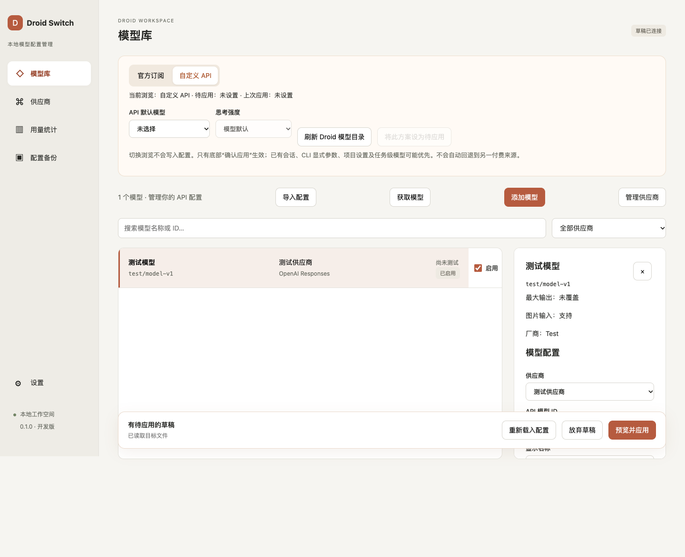

# Droid Switch

一个用于管理 **Factory Droid CLI** 模型与供应商配置的本地桌面工具。使用 Tauri 2、React、TypeScript 和 Rust 构建，草稿保存在本机 SQLite 中。

> 当前为 **0.1.0 测试版**。macOS Apple Silicon 已提供安装包；Windows 安装与真实会话行为仍待验证。项目为独立工具，与 Factory、OpenAI 没有官方关联。

[下载测试版](https://github.com/thin2/droidswitch/releases) · [反馈问题](https://github.com/thin2/droidswitch/issues) · [Windows 构建与实测](docs/windows-testing.md)

## 能做什么

- **管理多个供应商**：分别配置地址、协议和凭据，支持环境变量引用及直接填写 API Key。
- **获取或手动添加模型**：在供应商卡片获取模型列表，也可每行一个 ID 批量添加；同供应商重复条目跳过，已有参数保留。
- **区分模型来源**：相同模型 ID 可属于不同供应商，模型列表用供应商标签区分，并支持筛选。
- **管理官方/API 方案**：保存模型选择和思考强度配置，浏览不同方案不会立即改写 Droid。
- **预览后应用**：先保存草稿，再预览配置差异并确认写入；支持冲突检测、备份与恢复。
- **导入 CC Switch 配置**：只读导入来源数据，不修改 CC Switch；凭据导入需要按界面提示确认。
- **连接测试与用量界面**：可发起调用测试，查看支持格式的本地用量元数据。



*截图使用合成数据，部分界面可能与当前版本不同。*

## 安装

### macOS（M 系列芯片）

1. 前往 [Releases](https://github.com/thin2/droidswitch/releases)，下载 `.dmg` 附件。
2. 打开镜像，将 **Droid Switch** 拖入 **Applications**；替换旧版前先退出应用。
3. 安装包采用 ad-hoc 签名，尚未经过 Apple 公证。请核对下载来源及 Release 附带的 SHA-256 校验值。

当前附件为供应商模型管理版本；Release 说明会标明它与最新源码的差异。目前未提供 Intel Mac 安装包。

### Windows

暂未提供经过真机验收的 Windows 安装包。开发者可以按 [Windows 构建与实测](docs/windows-testing.md) 在本机生成 NSIS 安装程序。仓库包含 GitHub Actions 构建流程，**流水线成功不等于完成 Windows 真机验证**。

## 第一次使用

1. **准备 Droid CLI**：当前配置写入适配限定 **0.238.0**。在设置页确认应用能找到 Droid。
2. **添加供应商**：填写连接名称、服务商要求的基础地址和 API 协议。不要把模型厂商与 API 协议混为一谈；地址不会自动补删 `/v1`。
3. **配置凭据**：选择“直接写入 API Key”后填写密钥；或选择环境变量方式，只填写变量名，并确保启动 Droid 的终端能读取该变量。
4. **添加模型**：点击供应商卡片的“获取模型”；若服务商不提供目录接口，选择“手动添加模型”，每行填写一个准确 ID。
5. **选择方案并应用**：添加和编辑先保存草稿。选择 API 默认模型、设为待应用，再点击底部“预览并应用”，核对差异后确认。
6. **在 Droid 中验证**：重新启动 Droid 或开启新会话，在 `/model` 中选择并确认模型。已有会话、CLI 参数和项目级设置可能覆盖默认选择。

Droid Switch 不替代 Factory 登录。配置第三方 API Key 后，Droid 仍可能要求登录 Factory 账号。调用测试会向所选供应商发送请求，可能消耗额度。

### 常见问题

**获取不到模型怎么办？** 先确认协议、地址与凭据；部分供应商不提供模型列表接口，可以直接批量手动添加。手动添加不会验证该 ID 是否真实可用。

**同一个模型接入多个供应商会冲突吗？** 在本软件中它们是独立记录，可以按供应商筛选，分别配置参数。应用后仍需在你的 Droid 版本中确认选择结果。

**关闭 Droid 后为什么仍提示配置冲突？** 关闭进程不会恢复已经写入磁盘的内容。重新载入并核对接管关系；软件会保留草稿，真实内容变化或重复条目歧义仍会阻止覆盖。

## 数据与隐私

- 草稿、备份和支持格式的用量数据保存在本机。获取模型和调用测试会连接你配置的服务商。
- 直接填写的 API Key 可能以明文存在于本地数据库、Droid 配置及备份中。环境变量引用方式要求对应进程实际能读取变量。
- 本项目不附带可用的 API Key、Factory 登录信息或个人配置。请使用自己的账号与凭据。
- 提交 Issue 时请移除密钥、请求头、会话正文及个人路径；不要上传数据库、登录文件或配置备份。

## 当前限制

- Windows 安装、完整跨平台行为与部分 Droid 配置优先级仍待真实环境验收。
- 用量采集支持明确的元数据契约及具有稳定 ID/时间的兼容 SDK 导出，**尚未完整支持 Droid 原生会话日志**。未识别的数据不应视为零用量，详见 [支持范围](planning/droid-usage-contract.md)。
- Codex/ChatGPT 授权登录、本地代理和自动供应商回退尚未实现。
- 公共仓库从脱敏快照开始；规划记录中的旧本地提交号不一定能在公共历史中找到。

## 本地开发

需要 Node.js **≥22.12**、Rust **≥1.90**（建议 stable），以及 [Tauri 平台依赖](https://v2.tauri.app/start/prerequisites/)。macOS 可先运行 `bash scripts/setup-deps-macos.sh`。

```sh
git clone https://github.com/thin2/droidswitch.git
cd droidswitch
npm ci
npm run tauri dev
```

`npm run dev` 仅启动浏览器界面，不能代替桌面版操作真实本地配置。

### 检查与测试

```sh
npm run build
npm test
cargo test --locked --manifest-path src-tauri/Cargo.toml
cargo clippy --locked --manifest-path src-tauri/Cargo.toml --all-targets -- -D warnings
npm run test:ui
```

浏览器测试默认使用已安装的 Chrome，并通过合成 IPC 数据隔离真实配置。使用 Playwright Chromium 时先安装浏览器，再设置 `PLAYWRIGHT_CHANNEL=chromium`。可用 `PLAYWRIGHT_PORT` 指定独立测试端口。

### 打包

macOS：

```sh
npm run package:mac
```

Windows PowerShell：

```powershell
powershell -ExecutionPolicy Bypass -File .\scripts\build-windows.ps1
```

产物位于 `src-tauri/target/release/bundle/`。对外分发前，请检查签名、校验值及编译产物中可能嵌入的本机路径。

## 开发状态与反馈

[任务板](planning/codex-tasks.md) 由 dual-ai-planning 管理，`planning/tasks.json` 为状态来源；真实验收结果见 `planning/progress-reports/`。历史 UI 工作记录不代表所有功能已完成实机验收。

欢迎在 [Issues](https://github.com/thin2/droidswitch/issues) 中反馈，建议附上：操作系统与芯片、应用和 Droid 版本、复现步骤、预期结果及脱敏后的错误信息。

仓库目前未附开源许可证；公开可见不代表授予任意使用、修改或再分发的许可。
