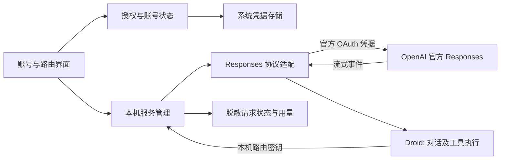

# ChatGPT 官方授权与本地路由方案（待评审）

> 后续源码调研已修订推荐路线：优先验证外接 CLIProxyAPI，再评估受管子进程集成。本文保留为自建 SIWC 路线基线，13–23 日不再作为所有方案的统一估算。见 [反代源码调研](20261011-proxy-implementation-review.md)。

日期：2026-10-11。状态：仅设计与任务拆分，未开始实现、未登录、未调用推理。任务 #050–#058 均 OPEN；不改变现有 Windows 实测和原生日志适配待办。

## 目标与复杂程度

在 Droid Switch 中通过官方网页授权 ChatGPT 账号，启动本机接口，把 Droid 的模型请求转发到已授权的官方 Responses 服务。用户不复制 OAuth Token，也不手填上游 API Key。

这是中高复杂度的新子系统：当前产品是配置管理器，新功能增加持续运行的请求服务。最难的是 Droid 多轮工具调用、流式失败处理及跨平台凭据续期。工程估算为单人 13–23 个有效开发日（约 3–5 周），含验证和返工余量但不含账号开通、官方能力变化及等待 Windows 实测；不是交付承诺。先用 2–4 个开发日做可行性样机，费用计入后续总量；若授权或工具协议不通，先收缩方案，不把文字聊天样机当成可用编程路由。

## 接入依据与必须先验证的前提

官方 OpenAI Docs 已描述面向开源应用的 Sign in with ChatGPT 订阅授权，符合条件的账号可授予推理权限。私人/商业分发的接入条件需要单独确认；项目尚未确定开源/分发方式，本方案不替用户发布仓库或承诺账号一定可用。[官方接入范围](https://developers.openai.com/siwc/quickstart)

授权采用独立的应用注册、系统浏览器及本机回调；身份登录成功与订阅推理授权成功分开判断。应用自己的注册与令牌不从现有 Codex 登录文件复制。[注册与授权](https://developers.openai.com/siwc/token-sharing-open-source/sign-in)

推荐走公开 Responses 端点。模型列表使用账号对应的目录；模型展示和实际可调用性分开验证。当前账号是否能授权、目标模型是否可用，以及 Droid 的请求能否完成工具闭环，本次均未实测。[模型与推理](https://developers.openai.com/siwc/token-sharing-open-source/models-and-inference)

订阅接口存在请求字段、工具和会话状态限制，需要适配。不能直接把普通 OpenAI API 流量无条件透传。[接口限制](https://developers.openai.com/siwc/token-sharing-open-source/preview-limitations)

## 路线比较

| 路线 | 适合情况 | 代价与结论 |
| --- | --- | --- |
| 官方订阅 OAuth → 本地 Responses 适配 | Droid 执行工具，只需模型能力 | 推荐。授权独立、工具职责清楚，需要协议与流式适配 |
| Codex app-server → 本地 API 包装 | 产品希望让 Codex 自己执行整个任务 | 多一层线程、工具审批和事件转换，容易形成两套 agent 循环；不作为本需求首选 |
| 常规 OpenAI API Key → 本地路由 | 正常 API 计费 | 可沿用供应商方式，但不满足本次订阅授权目标，不能静默替代 |

app-server 是官方应用嵌入入口，但不等于现成的通用 OpenAI HTTP 代理。[官方 app-server 接入](https://developers.openai.com/siwc/token-sharing-open-source/codex-app-server)

## 首版范围

支持 macOS、Windows；保存独立账号注册，用户手动选择一个活动账号，一次路由会话固定绑定该注册。支持官方授权、重新授权、刷新、退出、本机服务开关、可用模型选择、受管 Droid 连接、文本流式输出和函数工具调用。官方接口支持的其他输入不自动视作 Droid 已兼容：图片/文件先能力探测，未覆盖时明确报错。

不做账号轮询、自动切换付费来源、公网/局域网服务、通用 Anthropic 转换、Codex CLI 凭据导入、系统后台服务或复杂代理规则。工具仍由 Droid 执行。第一版关闭应用即停止服务；关闭窗口和退出行为需明确，不能让用户误以为退出后路由仍运行。

## 用户流程

1. 侧栏增加“账号与路由”，显示官方登录入口 Continue with ChatGPT（配中文说明）。
2. 系统浏览器完成授权；软件显示账号、订阅授权状态和可用模型。取消或权限不足保留可恢复状态。
3. 点击“启动本地路由”；显示本机地址、运行状态、当前账号/模型与最近错误。
4. 点击“添加到 Droid”，创建受管本机供应商草稿，沿用现有预览/确认应用/备份流程。后台令牌不出现在草稿、配置预览或导出中。
5. Droid 新会话选择该模型。关闭路由、到达额度或授权失效时给出明确错误与恢复入口。

Factory 官方订阅与 ChatGPT 订阅不能都叫“官方订阅”：现有页签改为“Factory 订阅”，新来源清晰标注“ChatGPT 订阅 · 本地路由”。底层 Droid 仍使用自定义 API 配置，不伪装成 Factory 内置模型。

## 结构与复用

- 复用：Tauri/React 框架、供应商/模型列表、SQLite、原子配置写入、预览和备份、已有模型 ID 边界。
- 新增 Rust 模块建议：auth/openai、auth/vault、router/server、router/responses、router/lifecycle、router/usage；新增前端 accounts/RouterPage。
- 现有 net.rs 一次性读取整个响应、上限 1MiB，不适合长流式推理；新增独立传输层，保留现有测试/模型获取行为。
- 新依赖候选：HTTP 服务与异步运行时、OIDC/JWT 验证、系统凭据存储、流解析。实现前核对兼容性，不在本轮安装。
- 新数据只在正式实现时迁移：账号元数据/凭据引用、稳定主机 ID、路由端口与状态、受管供应商绑定、请求摘要。OAuth 密钥不进入普通供应商明文字段。

## 模块设计与边界

### 授权与凭据

每次登录使用独立 state/nonce/PKCE，回调仅绑定 127.0.0.1 临时端口；验证 OIDC 签名、issuer、audience、有效期、nonce，返回账号与原注册对应。稳定 host ID 每安装一份，正式 client ID 按账号/工作空间注册保存；登录尝试失败不能覆盖已用账号。

令牌建议保存到 macOS Keychain / Windows Credential Manager，SQLite 只保存引用与必要元数据。相同注册的刷新串行化，刷新后原子替换最新凭据；锁屏/存储不可用要有明确状态。退出先停止该注册新请求并取消其流，再尝试撤销会话及清理本地凭据。远程撤销失败如实提示。[账号与会话](https://developers.openai.com/siwc/token-sharing-open-source/profiles-and-sessions)

### 本机服务

仅监听 127.0.0.1。生成与上游 Token 无关的随机路由密钥，验证每个请求；校验 Host/Origin，拒绝任意网页跨域访问。Droid 配置只保存本机密钥。上游主机固定，不能把此服务变成任意 URL 转发器。

首版提供 GET /v1/models、POST /v1/responses 和受保护健康检查。端口首次分配后持久化；被占用时提示处理，不静默换端口导致旧配置失效。有限并发、请求体上限、流事件大小上限和背压；客户端取消立即向上游取消。停止期间不接新请求，退出释放端口。明确总时限与无数据时限，不套用当前短请求超时。

### 协议兼容——工作量最大的模块

先录制无敏感内容的 Droid 合成请求：单轮、多轮、函数调用、工具结果、并行调用、取消和异常。按实际 Droid 版本做字段矩阵：原样支持、确定性转换、明确拒绝。Droid 执行工具，本机服务只传输调用及结果。

订阅请求需要流式响应及不保存上游状态。若 Droid 只给 previous_response_id，应验证能否配置为发送完整历史；否则需要有界会话状态管理，历史丢失明确失败，不能静默丢上下文。系统消息到 instructions/developer 的转换需保持原优先级与顺序；工具名称/命名空间与 call ID 往返不能改变含义。不能通过简单删除不支持字段伪造兼容。

按 UTF-8/SSE 帧边界处理拆包、心跳、工具参数增量及最终事件。区分正常完成、取消、部分输出后失败；收到 HTTP 200 不表示成功。已输出内容后不自动重放生成请求。登录刷新重试仅允许确定尚未产生生成结果的情形。[错误恢复](https://developers.openai.com/siwc/token-sharing-open-source/errors-and-recovery)

上游模型目录与现有 data[].id 格式不同，增加专用解析器并对 Droid 输出本机兼容列表。模型 ID 保持上游返回值，不编造支持型号。

### 状态、配置与用量

账号状态：未登录 → 授权中 → 已登录但无订阅权限 / 可用 → 刷新中 / 需重新登录。
路由状态：停止 → 启动中 → 运行 → 停止中；端口冲突、凭据不可用、上游故障独立展示，不能全变成“连接失败”。

对话开始后绑定账号注册；切换活动账号影响新会话，原会话保持原绑定，凭据撤销则失败，不混用不同账号历史。

现有 Source 枚举保留 Factory/API 两类配置行为，新增管理侧来源标签表示订阅路由；启用前检查路由健康，暂停路由不自动重写 Droid 默认模型。草稿、导出和备份不含上游 OAuth 凭据。

用量仅记录完成/失败状态、模型、时间、官方返回的 token 计数和请求 ID，不记录正文/工具参数。归为 ChatGPT 订阅，不能记成 Factory credits 或普通 API 费用；未知额度显示未知并提供官方用量入口。代理观测到的请求可独立统计，不依赖尚未完成的原生日志格式 #039，按请求 ID 去重。

## 阶段、工时与退出条件

| 任务 | 内容 | 工程估算 | 依赖与验收重点 |
| --- | --- | --- | --- |
| #050 | 接入资格与 Droid 协议可行性验证 | 1–2 日 | 确认分发条件；真实授权、一个流请求和工具往返证据；失败输出受限方案 |
| #051 | OAuth/OIDC 与账号注册 | 2–3 日 | #050；身份/权限/取消/错误回调，假服务测试 |
| #052 | 凭据存储、续期与注销 | 1–2 日 | #051；刷新竞态、系统存储失败、撤销失败 |
| #053 | 本机 HTTP 服务与生命周期 | 1–2 日 | #050；鉴权、端口、取消、并发、退出 |
| #054 | Responses/SSE/多轮工具适配 | 3–5 日 | #051/#052/#053；真实 Droid 工具闭环与断流，最高风险 |
| #055 | 受管模型与配置接入 | 1–2 日 | #054；预览/备份复用，恢复和无 Token 泄漏 |
| #056 | 账号与路由页面 | 1–2 日 | #052/#053/#055；可恢复状态、身份展示、启停交互 |
| #057 | 用量与故障诊断 | 1–2 日 | #054/#056；不误算费用、不保存敏感内容 |
| #058 | Windows/macOS 验收与分发 | 2–3 日 | #055/#056/#057；安装重启、续期、锁屏、端口冲突、撤销 |

#050 是决定是否进入正式实现的技术门槛。本轮只规划，未消耗用户订阅。首次真实授权必须由用户在官方页面完成；真实推理会使用账号额度，在进入验证时说明具体测试。没有有效账号或 Windows 环境时不能把集成验收标为通过。

最小样机（约 2–4 日，含部分 #051/#053/#054）：官方授权 + 一个本机接口 + 一个 Droid 文本/工具往返，不带完整 UI 和后台恢复。可交付首版必须完成上表所有模块；测试不通过时重新评估，不承诺用普通 API 付费绕过。

## 完成标准

- 两平台安装后可以完成官方授权、重启恢复、续期与退出；无权使用订阅时不能进入可用状态。
- 从 UI 创建受管连接到 Droid 新会话的文字与工具执行闭环真实成功；流取消、错误与额度耗尽可观察。
- 账号隔离、错误鉴权、端口冲突、并发刷新、半途断流均有回归；日志/配置导出不出现上游凭据或正文。
- 本机关闭应用的结果符合页面说明；配置恢复可用，现有 API Key 和 Factory 订阅流程不回归。
- Windows 验收必须用实际构建运行结果；交叉编译与假接口测试不能替代。

## 待确认项与决策建议

建议先批准范围为“个人本机使用、一个活动账号、Responses、Droid 执行工具”，保留账号手动选择，不做并发账号池。项目开源/私人分发条件留在 #050 确认；本轮不为此中断规划。若想要 Codex 自己执行整个任务，应另做 app-server 集成方案，不混进本首版。
